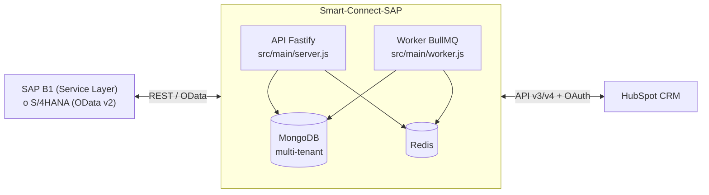
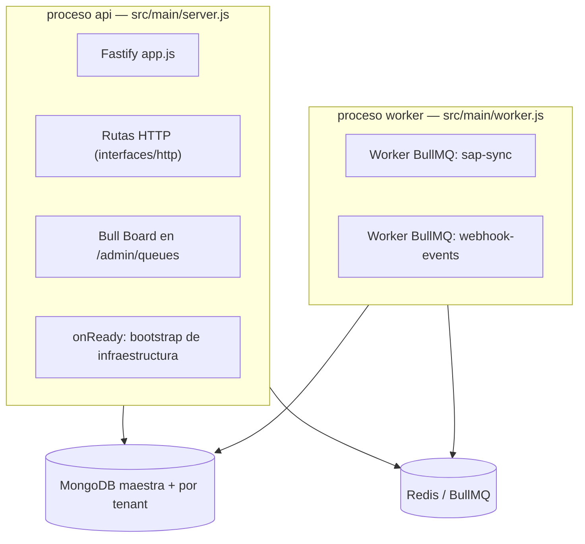
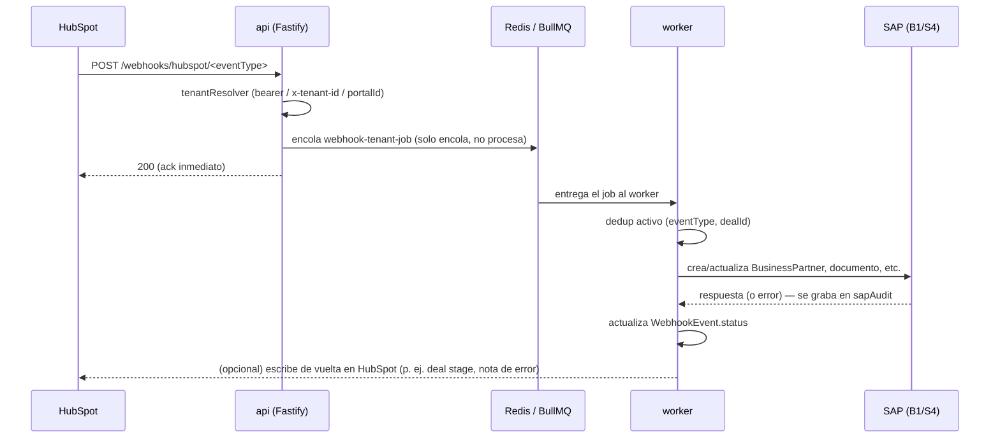
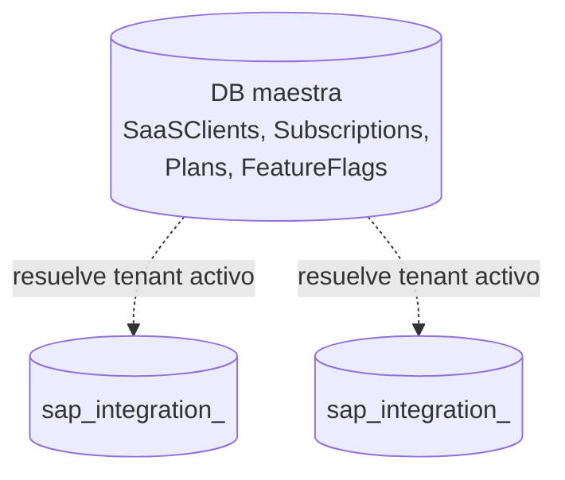

# Arquitectura — Smart-Connect-SAP

> Verificado contra el commit `1305b31` (2026-10-11), HEAD actual de `main`.

## 1. Qué es el sistema

Conector **bidireccional SaaS multi-tenant** entre SAP y HubSpot CRM:

- **SAP → HubSpot**: sync nocturno/programado de compañías, contactos, productos, deals/facturas.
- **HubSpot → SAP**: procesamiento de webhooks (creación de deals, cotizaciones, conversión a orden, traslados de inventario, ofertas de compra).

Convive con **dos "sabores" de SAP** por tenant (campo `sapFlavor`):
- **Business One (B1)** vía Service Layer (REST propio de SAP).
- **S/4HANA** vía Gateway OData v2 (cliente actual: Multiquímica).

Stack: Node.js ESM + Fastify + MongoDB/Mongoose (una base por tenant) + Redis/BullMQ + Winston.
Arquitectura: hexagonal/clean architecture, sin contenedor DI de terceros — el *composition root* (`src/composition/`) son factory functions puras que ensamblan casos de uso con adaptadores concretos.

## 2. Diagrama de alto nivel

## 3. Componentes (dos procesos, una base de datos)

- **`api`**: expone las rutas HTTP (admin, webhooks entrantes de HubSpot, OAuth, health). Las rutas de webhook **solo encolan** el evento — no lo procesan. También levanta Bull Board (dashboard de colas) en `/admin/queues`.
- **`worker`**: no expone HTTP ni cron propio. Es consumidor puro de dos colas BullMQ: `sap-sync` y `webhook-events`.
- Ambos procesos corren la **misma imagen Docker** y comparten Mongo y Redis.
- `src/bootstrap/appLifecycle.bootstrap.js` (solo en `api`, hook `onReady`) siembra configuraciones default y sincroniza los *job schedulers* de BullMQ contra la base de datos al arrancar.

> El cron interno de sync (`SAP_SYNC_CRON_ENABLED`) está muerto por código (`if (false)` en `sapSyncTask.js`). El disparo real de syncs programados es 100% BullMQ Job Scheduler.

## 4. Flujo de sync SAP → HubSpot (nocturno / programado)

1. **Trigger**: BullMQ Job Scheduler dispara un job `sap-sync-job` para una combinación `(tenant, ClientConfig)`, según la frecuencia configurada (`executionTime`, uno o varios horarios `HH:mm`, zona horaria `America/Costa_Rica`), o se dispara manual vía `POST /sap-sync/run`.
2. **Lock**: el worker adquiere un lock Redis por tenant (`lock:sap-sync:<tenantKey>`) para que no corran dos syncs del mismo tenant en simultáneo.
3. **Selección de caso de uso**: según `ClientConfig.taskType` (`SAP_SYNC` o `DROPDOWN_OPTIONS`), se resuelve el caso de uso correspondiente.
4. **Fetch a SAP**: se construye el filtro (`FULL` vs `INCREMENTAL`, con `UpdateDate ge <ISO>` para incremental) y se consulta el Service Layer (B1) u OData (S/4).
5. **Mapeo**: `FieldMappingService` aplica los `FieldMapping` configurados (SAP → HubSpot) más "dynamic description".
6. **Enriquecimiento**: hasta 4 *enrichers* (`SapRecordEnricherPort`) adjuntan datos extra sin abortar el sync si fallan (contactos de empresa en S/4, stock de bodega, lotes/vencimiento, flags `Properties1..64` en B1).
7. **Matching/Identity**: un índice CRM en memoria (`CrmObjectIndex`) resuelve qué registro de HubSpot corresponde a cada registro SAP, por la *identity property* configurada (evita duplicados por búsquedas 1-a-1).
8. **Envío a HubSpot**: batch create/update vía API v3, con reintento/backoff y clasificación de fallos parciales (207).
9. **Auditoría**: se escribe un `SyncLog` (contadores `sent`/`updated`/`skipped`/`errors`) y, si aplica, `SyncWarning` por registro.
10. **Release del lock** en `finally`, se libere o falle el job.

## 5. Flujo de webhooks HubSpot → SAP

Tipos de evento (`eventType`) soportados hoy: `createDeal`, `createQuotation`, `updateQuotation`, `convertQuotationToOrder`, `inventoryTransferRequest`, `purchaseQuotation`. Hay además un webhook separado para precios de línea (`line-items/prices` para B1, `line-items/prices/s4` para S/4).

Puntos clave:
- **Dedup con reenvío**: `dedupActive` + índice único parcial evita procesar el mismo deal dos veces; solo el estado `errored` libera el cupo para reintentar.
- **Auditoría SAP**: cada webhook graba todas las llamadas que hizo a SAP (incluidas las que fallaron) en `WebhookEvent.sapAudit`, sin headers (la cookie de sesión no se persiste).
- **Sin verificación de firma**: el tenant se identifica por `x-tenant-id`/`portalId`/bearer propio, pero no hay validación de `X-HubSpot-Signature`. Queda documentado como pendiente ("Fase B").

## 6. Servicios Docker

`docker-compose.yml` levanta dos servicios con la misma imagen (`Dockerfile`, `node:20-alpine`):

| Servicio | Comando | Puerto | Redes |
|---|---|---|---|
| `api` | `npm run start:api` | `${PORT:-3000}:3000` | `default` + `mongo` (externa) |
| `worker` | `npm run start:worker` | — | `default` + `mongo` (externa) |

- La red `mongo` es **externa** (`mongodb-4-kfyz_default`): en el VPS de producción, Mongo corre en *otro* proyecto docker-compose. Si `api`/`worker` no se unen a esa red, fallan con `EAI_AGAIN` en loop y nginx devuelve 502.
- No hay `volumes:` definidos — `logs/app.log` vive dentro del contenedor y se pierde al recrearlo.
- Variables de entorno van por `.env` (no versionado). Placeholders típicos: `<MONGO_URI>`, `<REDIS_URL>`, `<INTERNAL_KEY>`, `<HUBSPOT_CLIENT_ID>`, `<HUBSPOT_CLIENT_SECRET>`.

## 7. Dependencias

### MongoDB (tres niveles)

- **Maestra**: `SaaSClients`, `Subscriptions`, `Plans`, `FeatureFlags`, plantillas de `ClientConfig` por defecto.
- **Por tenant**: una base `sap_integration_<tenantKey>` por cliente (hoy: `amc`, `distelsa`, `noelito`, `printer` en producción; `multiquimica` corre sobre Mongo local, ver `clientes.md`). El nombre lo arma `buildTenantDatabaseName(tenantKey)` = `<TENANT_DB_PREFIX|sap_integration>_<tenantKey>`.
- **Importante**: el Mongo de producción es **< 5.0** y rechaza claves que empiecen con `$` en documentos — los tests de integración con `mongodb-memory-server` (≥5.0) sí las aceptan, así que "tests verdes" no garantiza que el documento se pueda guardar en producción. Ver detalle en `decisiones-y-problemas.md`.

#### Multi-tenencia: por qué una migración debe cubrir los 4 tenants

Cada cliente tiene su propia base Mongo; no hay una base compartida ni un flag de tenant dentro de las colecciones. Cualquier cambio de esquema, índice o migración de datos es **por tenant**, nunca global. El riesgo concreto: Mongoose con `autoIndex` activo (el default en este proyecto) crea el índice **nuevo** de un schema apenas el proceso se conecta a esa base, pero **sin backfill** — los documentos que ya existían quedan fuera de las garantías del índice nuevo (p. ej. un índice único parcial) mientras el índice viejo todavía bloquea otras rutas. Si se despliega el código nuevo y se corre la migración de datos en un solo tenant, los otros tres quedan en un estado **peor** que el inicial: el esquema ya cambió (porque el mismo binario/imagen corre para todos) pero los datos no.

Ya pasó en la migración del dedup de `WebhookEvent` (reenvío de webhooks, 2026-09): se migró `printer` primero y los otros tres quedaron un rato en ese hueco. Regla operativa: **dry-run en los cuatro tenants antes de aplicar en ninguno**, y volver a correr el dry-run después para verificar el estado final. Del lado de HubSpot la separación también es por tenant (un portal por cliente), así que propiedades, `Configuration` y workflows se replican y validan cuatro veces, no una.

### Redis / BullMQ

- Conexión dedicada (singleton) reutilizada por colas y locks distribuidos.
- Dos colas: `sap-sync` (reintentos `attempts=20`, backoff exponencial) y `webhook-events` (`attempts=1`, sin reintento automático — un solo job por tenant).
- Locks: uno para la ejecución del sync por tenant (`tenantSapSyncLock`), otro independiente para la sesión SAP (cookie `B1SESSION` cacheada, con TTL atado al `SessionTimeout` de SAP).

## 8. Seguridad — estado conocido

- **Abierto**: Bull Board (`/admin/queues`) sin autenticación.
- **Resuelto**: rutas admin requieren `x-internal-key` + `x-tenant-id`; `POST /sap-sync/run` y `/runWebHook` requieren `x-internal-key`.
- **Resuelto**: el `state` de OAuth va firmado (HMAC) y con vencimiento.
- **Abierto**: webhooks de HubSpot no verifican firma (`X-HubSpot-Signature`); el tenant se resuelve por header/body, no por autenticación criptográfica.
- `<INTERNAL_KEY>` abre la configuración de **todos** los tenants — nunca debe llegar a un frontend/navegador.

## Fuentes

- Bóveda Obsidian `Smart-Connect-SAP`: `01-Arquitectura.md`, `04-Infraestructura.md`, `Index.md` (al día con commit `1305b31`, 2026-10-11).
- Repo: `docker-compose.yml`, estructura de `src/bootstrap/`, `src/composition/`, `src/main/`, `src/infrastructure/queue/`, `src/infrastructure/scheduler/` (confirmado que los nombres de archivo y servicios siguen existiendo).

**Nota de seguridad para quien reciba este handoff**: la bóveda Obsidian señala que dos specs en `docs/superpowers/specs/` contienen credenciales en texto plano del S/4 de Multiquímica. Revísense y sanéense antes de compartir el repo o la carpeta `docs/` con terceros; no se copiaron a este paquete de handoff.
